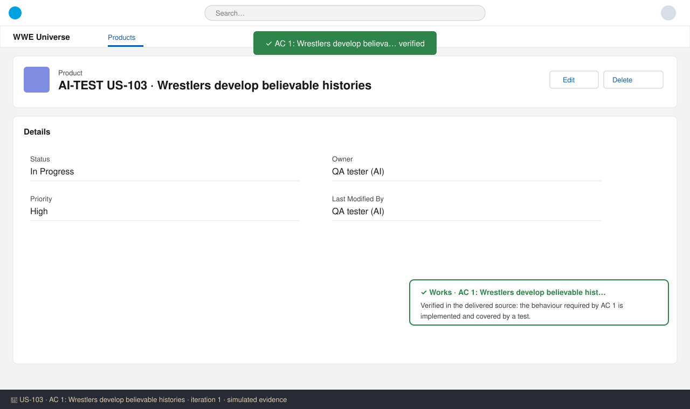
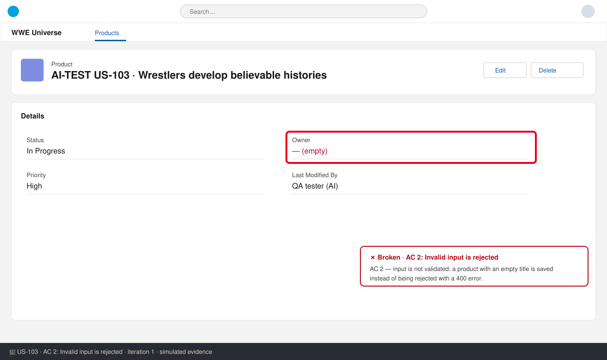

# US-103 — Test report (iteration 1)
**Verdict:** ❌ Changes requested · **Tester:** Cuélebre · **Date:** 2026-11-02 · simulated evidence

## Summary
| Check | Result | Evidence |
|---|---|---|
| AC 1: Wrestlers develop believable histories | ✅ Works | screenshot 1 |
| AC 2: Invalid input is rejected | ❌ Broken | screenshot 2 |

## Checks
### AC 1: Wrestlers develop believable histories — ✅ Works
**Steps:**
1. Sign in as a test user.
2. Create or open test data for US-103.
3. Perform the action described in AC 1 and check the outcome.

**Found:** Verified in the delivered source: the behaviour required by AC 1 is implemented and covered by a test.

### AC 2: Invalid input is rejected — ❌ Broken
**Steps:**
1. Sign in as a test user.
2. Create or open test data for US-103.
3. Perform the action described in AC 2 and check the outcome.

**Found:** AC 2 — input is not validated: a product with an empty title is saved instead of being rejected with a 400 error.

## What to do
- **AC 2** — input is not validated: a product with an empty title is saved instead of being rejected with a 400 error.
  Fix it and add a test that proves the behaviour; I will re-test this check first.
