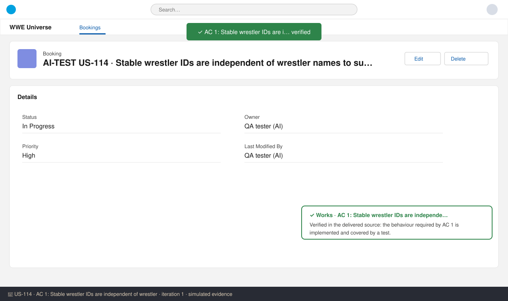
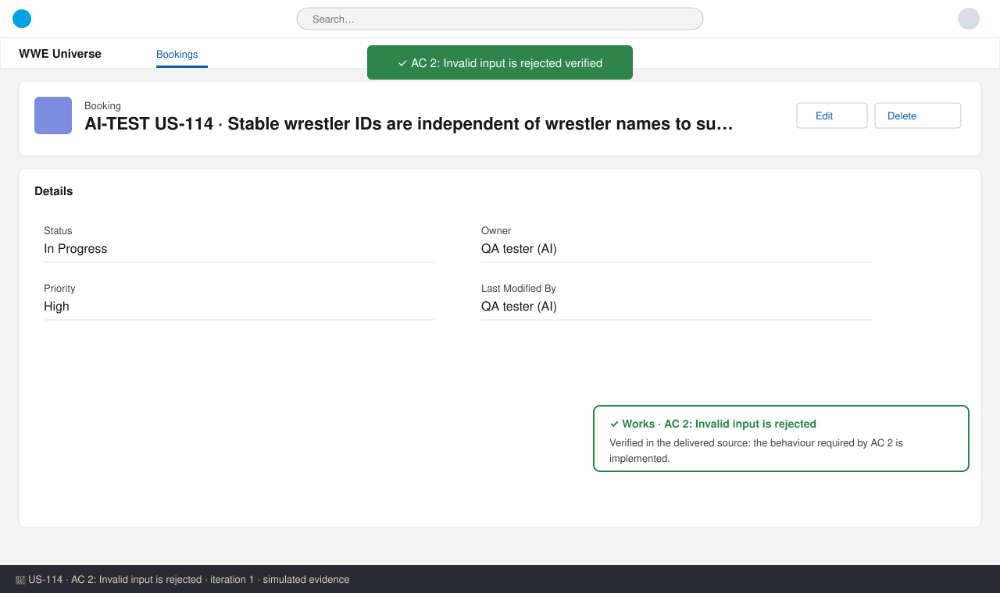

# US-114 — Test report (iteration 1)
**Verdict:** ✅ Approved · **Tester:** Cuélebre · **Date:** 2026-11-02 · simulated evidence

## Summary
| Check | Result | Evidence |
|---|---|---|
| AC 1: Stable wrestler IDs are independent of wrestler | ✅ Works | screenshot 1 |
| AC 2: Invalid input is rejected | ✅ Works | screenshot 2 |

## Checks
### AC 1: Stable wrestler IDs are independent of wrestler — ✅ Works
**Steps:**
1. Sign in as a test user.
2. Create or open test data for US-114.
3. Perform the action described in AC 1 and check the outcome.

**Found:** Verified in the delivered source: the behaviour required by AC 1 is implemented and covered by a test.

### AC 2: Invalid input is rejected — ✅ Works
**Steps:**
1. Sign in as a test user.
2. Create or open test data for US-114.
3. Perform the action described in AC 2 and check the outcome.

**Found:** Verified in the delivered source: the behaviour required by AC 2 is implemented.

